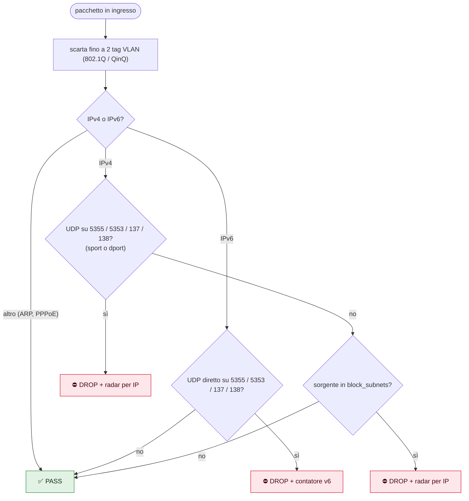
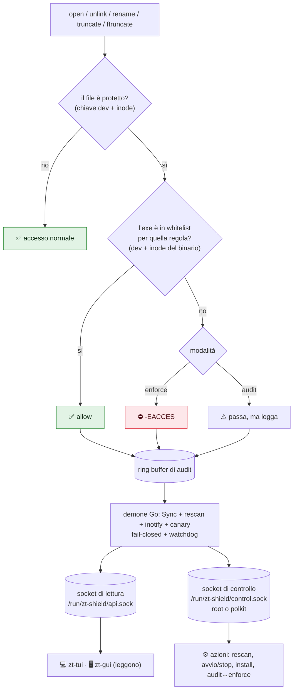

<p align="center">
  
</p>
<h1 align="center">ZeroShield</h1>
<p align="center"><b>Uno scudo zero-trust locale nel kernel Linux.</b><br/>
Difende segreti e rete di una postazione da Wi-Fi ostili, dipendenze avvelenate e ladri di token: senza server, senza cloud, senza account.</p>
<p align="center">
  <a href="#-stato-reale-del-progetto">Stato</a> ·
  <a href="#-demo-in-60-secondi-dati-finti">Demo</a> ·
  <a href="#-installazione">Installazione</a> ·
  <a href="#-interfacce">Interfacce</a> ·
  <a href="#-configurazione">Configurazione</a> ·
  <a href="#-documentazione">Documentazione</a>
</p>
<p align="center"><i>MIT © 2026 ZioZoni95 · binari: <code>zt-shield</code> <code>zt-tui</code> <code>zt-gui</code> <code>zt-mockd</code> <code>zt-probe</code></i></p>
<p align="center">
  <a href="https://github.com/ZioZoni95/ZeroShield/actions/workflows/ci.yml"></a>
  
  
  
  
  
</p>

> [!WARNING]
> **Alpha sperimentale, mai provata su una macchina fisica.** Gli hook LSM che proteggono i
> segreti sono accettati dal verifier del kernel ma **non sono mai stati agganciati** su un kernel
> con BPF LSM attivo: il blocco effettivo dei file non è stato ancora visto funzionare. Il demone
> `zt-shield` non è mai stato avviato per intero. Usalo in una **VM con snapshot** e in modalità
> `audit` finché il collaudo di [`docs/TESTING_LAB.md`](docs/TESTING_LAB.md) non passa sulla tua
> macchina. Dettagli e cronologia in [`docs/TEST_SANDBOX.md`](docs/TEST_SANDBOX.md).

---

## 📋 Indice

1. [Stato reale del progetto](#-stato-reale-del-progetto)
2. [Cos'è, e cosa non è](#-cosè-e-cosa-non-è)
3. [Demo in 60 secondi](#-demo-in-60-secondi-dati-finti)
4. [Come funziona](#-come-funziona)
5. [I livelli di protezione](#-i-livelli-di-protezione)
6. [Profili e regole](#-profili-e-regole)
7. [Configurazione](#-configurazione)
8. [Prerequisiti](#-prerequisiti)
9. [Installazione](#-installazione) · [Release](#-le-release-cosa-contengono) · [Da sorgente](#-da-sorgente)
10. [Primo avvio sicuro](#-primo-avvio-sicuro)
11. [Interfacce](#-interfacce)
12. [Test e CI](#-test-e-ci)
13. [Struttura della repository](#-struttura-della-repository)
14. [Limiti noti](#-limiti-noti)
15. [Documentazione](#-documentazione)

---

## 🔬 Stato reale del progetto

Ultima release pubblicata: **v0.0.3** (pre-release). Il codice in `main`/nei branch può contenere
modifiche non ancora rilasciate: vedi [`CHANGELOG.md`](CHANGELOG.md).

| Componente | Stato | Come è stato verificato |
|---|---|---|
| XDP anti-poisoning (IPv4 + IPv6, fino a 2 tag VLAN) e radar | ✅ **kernel reale** | `zt-probe -xdp-lo` (5355/5353 droppati, 9999 passa) + 20 pacchetti sintetici contro il vero programma (`BPF_PROG_TEST_RUN`, [`bpf/xdp_prog_test.go`](bpf/xdp_prog_test.go)) |
| Canary anti-ransomware (fanotify) | ✅ **kernel reale** | tocco esca, allarme di massa, kill in `enforce` (`make test-root`) |
| **Hook LSM dei segreti** (5 programmi) | 🟡 **verifier ok, mai agganciati** | `zt-probe` sul runner GitHub: tutti e 5 accettati. Attach e blocco reale **mai visti**: da provare in VM |
| **Demone `zt-shield` end-to-end** | ⚠️ **mai avviato** | senza BPF LSM si ferma di proposito (fail-closed). IPC, VPN e porte in ascolto sono testati a pezzi, **mai insieme** |
| Config, IPC, audit, whitelist, selezione file, inotify, `netstat` | ✅ test unitari | `go test -race`, fuzz sul config, CI; socket IPC provato con utenti reali |
| TUI / GUI / mock | ✅ testati | TUI: test unitari + `--dump`. GUI: app vera sotto Xvfb contro `zt-mockd` + 21 controlli nel browser |
| Pacchetti `.deb` | ✅ costruiti, installati e rimossi | release v0.0.1–v0.0.3 pubblicate (pre-release, solo lab) |
| Kill-switch VPN (`vpn_killswitch.sh`) | 🟡 network namespace | 54 controlli (`scripts/test_killswitch.sh`): mai su una rete reale né con un tunnel vero |
| Auto-VPN (`nm_vpn.sh`), helper Proton | 🟡 comandi finti | 28 e 19 controlli: mai con NetworkManager né ProtonVPN veri |
| `harden_system.sh` | 🟡 comandi finti | `--dry-run` + 21 controlli (`scripts/test_harden.sh`): mai su un sistema vero |
| `setup_fido2.sh` | ⚠️ mai eseguito | solo `shellcheck` / `bash -n` |
| Unit systemd (sandboxing aggiuntivo) | 🟡 solo sintassi | validata con `systemd-analyze verify`; il servizio non è mai stato avviato |

**Cosa significa in pratica:** puoi guardare le interfacce con dati finti e provare XDP e canary su
un kernel vero. **Non** puoi ancora fidarti che i tuoi segreti siano protetti.

---

## 🧭 Cos'è, e cosa non è

`zt-shield` è un agente di sicurezza locale per postazioni Linux (sviluppo e uso quotidiano) che
lavorano su reti non fidate o su cui può girare codice non fidato. Applica il paradigma
**Zero-Trust** a livello kernel con **eBPF (XDP + LSM)**, affiancato da hardening del sistema,
esche anti-ransomware, monitor e kill-switch VPN e firma dei commit con credenziali hardware.

**È:** anti-furto di segreti locali, anti-poisoning di rete, esche anti-ransomware, monitor VPN.
**Non è:** un antivirus, un firewall completo (niente egress per processo), un EDR, un backup, né
uno strumento di cifratura. Root locale, keylogger e disco non cifrato restano fuori scopo.

| Scenario | Minaccia | Cosa fa lo scudo |
|---|---|---|
| **Wi-Fi pubblico** | Poisoning LLMNR/mDNS/NBT-NS, ARP spoofing, DNS ostile, scansioni | Drop XDP dei protocolli di poisoning, firewall `deny incoming`, DNS cifrato (DoT) ignorando quello del DHCP, sysctl anti-redirect/ARP |
| **Supply-chain** (dipendenza npm/PyPI/Cargo compromessa, `curl \| sh`) | Il codice gira con i tuoi permessi e legge `~/.ssh`, `~/.aws`, token | LSM: solo i binari in whitelist aprono i segreti; ogni altro tentativo è negato e loggato con PID ed exe |
| **Infostealer** | Esfiltrazione di cookie e password del browser, chiavi, wallet | Regole `browsers`, `gpg`, `tokens` + regole tue (`extra_rules`) |
| **Ransomware** | Cifratura e cancellazione di massa dei documenti | Esche fanotify: chi le tocca viene ucciso in `enforce`; raffiche di rename/delete → allarme |
| **LAN domestica o aziendale** | Dispositivi compromessi, Responder/Inveigh, movimento laterale | `deny incoming`, drop poisoning, `block_subnets` opzionale |
| **Furto di identità** | Chiave SSH rubata, commit falsificati | Chiavi FIDO2 `ed25519-sk` (PIN + tocco), commit firmati |

---

## ⚡ Demo in 60 secondi (dati finti)

Non prova la protezione (nessun kernel coinvolto): mostra solo le interfacce con dati inventati.
Non serve root.

```bash
make build-tui build-mock
ZT_SOCKET=/tmp/z.sock ./bin/zt-mockd &
ZT_SOCKET=/tmp/z.sock ./bin/zt-tui     # tab: Stato · Eventi · Regole · Rete · Radar · Config
```

Anteprima statica senza terminale interattivo: `./bin/zt-tui --dump`. Per la GUI:
`ZT_SOCKET=/tmp/z.sock ./bin/zt-gui` (dopo `make gui` o `make gui-bin`).

---

## 🏗️ Come funziona

Il demone `zt-shield` gira come root, carica i programmi eBPF e pubblica stato ed eventi su un
socket Unix che TUI e GUI leggono come utente normale.

**Rete (XDP):** ogni pacchetto in ingresso, prima dello stack di rete.



**Segreti (LSM):** ogni `open`, `unlink`, `rename`, `truncate` del sistema passa da una lookup.



Il confine tra userspace e kernel è fatto di **numeri**, non di stringhe: per ogni file protetto
si mette in mappa `(device, inode)` e il kernel confronta i propri numeri con l'oggetto che sta per
essere aperto. Per questo la whitelist non si aggira con symlink, rename o copie del binario:
conta l'identità del file, non il nome con cui lo chiami.

---

## 🎯 I livelli di protezione

### 1. Rete: eBPF XDP + firewall
* **Drop dei protocolli di poisoning:** LLMNR (5355), mDNS (5353), NBT-NS (137) e NetBIOS-DGM (138),
  guardando sia la porta sorgente sia quella di destinazione (la risposta avvelenata di
  Responder/Inveigh ha `sport=5355`). Attivo di default (`block_poisoning`).
* **IPv4 e IPv6**, anche dietro uno o due tag VLAN (QinQ). Su IPv6 il drop vale se UDP è il
  next-header diretto (con extension header passa); il radar delle UI è IPv4, per IPv6 il demone
  logga un totale. DHCPv6 non è toccato.
* **Blocco subnet opzionale** (`block_subnets`, Longest Prefix Match, solo IPv4). Scarta anche le
  risposte da quelle reti: mai gateway o DNS dentro; prefissi più larghi di `/8` sono rifiutati.
* **XDP generico:** funziona su Wi-Fi, Ethernet e VPN; `interface` accetta una lista (`wlan0,eth0`).
* **Radar:** contatori per IP sorgente (LRU da 1024), mostrati nelle UI.
* **Firewall:** UFW `default deny incoming` via `harden_system.sh`.

### 2. Segreti: eBPF LSM
* **Hook:** `file_open`, `inode_unlink`, `inode_rename` (sorgente e destinazione), `path_truncate` e,
  sui kernel ≥ 6.2, `file_truncate` (`ftruncate` su fd aperto). L'ultimo è **opzionale**: il demone lo
  carica solo se il BTF del kernel espone `bpf_lsm_file_truncate`, e se solo lui non si carica parte
  comunque, dicendolo nel log.
* **Regole per gruppo di segreti:** ogni regola associa file (percorsi, glob, directory ricorsive) ai
  soli binari autorizzati. Solo **binari di root** non scrivibili da altri entrano in whitelist
  (altrimenti `cat evil > ~/.local/bin/aws` erediterebbe l'autorizzazione).
* **Lettura vs scrittura:** una apertura in sola scrittura passa (chiavi e backup funzionano);
  `O_TRUNC`, `truncate(2)` e `ftruncate` passano dalla whitelist. Per segreti immutabili esiste
  `deny_write` per regola.
* **Mappe a prova di diluvio:** i file *nominati* dalle regole hanno la precedenza; quelli scoperti
  camminando dentro una directory sono al massimo 4096 per regola (tetto totale 16384). Un processo
  che riempie `~/.mozilla` di file finti non spinge fuori le chiavi vere, e il log dice quanti file
  restano scoperti.
* **Finestra di rescan chiusa:** un watcher **inotify** sulle directory dei segreti lancia un rescan
  entro ~0,5 s (con debounce) quando un file compare, sparisce o viene rinominato, perché un segreto
  riscritto via rename cambia inode. Il rescan periodico (`rescan_seconds`, default 30) resta come
  rete di sicurezza e copre anche i binari aggiornati da apt.
* **Modalità `audit` / `enforce`:** `audit` logga senza bloccare, `enforce` nega con `-EACCES`.
* **Audit in tempo reale:** ogni evento riporta regola, PID, `comm` ed `exe`; formato `text` o `json`.
* **Fail-closed:** se un hook LSM non si aggancia, il demone si ferma invece di fingersi attivo.
* **Difese del demone:** il filtro sul proprietario scarta i symlink dell'utente verso file di sistema
  (altrimenti `~/.ssh/id_x -> libc.so.6` bloccherebbe la macchina); `ZT_SOCKET` e `ZT_CONTROL` sono
  ignorati se il demone gira come root.

### 3. Anti-ransomware: canary + fanotify
* **Esche:** file finti e nascosti (`.canary-*.xlsx`, `.dat`, `.zip`) nelle cartelle scelte; nessun uso
  legittimo li apre. Nascono di proprietà dell'utente protetto (non di root) e si scrivono con
  `O_EXCL|O_NOFOLLOW`.
* **Tocco esca:** `SIGKILL` al processo in `enforce`, allarme in `audit`. Mai kill di PID ≤ 1 né del
  demone stesso.
* **Massa:** troppe scritture/cancellazioni/rinomine di un PID in pochi secondi → allarme (mai kill).
* **Eccezioni:** `exclude_exe` (sottostringhe) esenta dal solo allarme di massa; `allow_exe` (percorsi
  esatti, solo binari di root) esenta dal tocco esca per indicizzatori e backup.
* **Sotto systemd:** la unit monta la home in sola lettura; `zt-shield dropin` genera il drop-in
  `ReadWritePaths=` per le sole cartelle delle esche (lo applica già `install_service.sh`).
* **Spento di default:** si tara una settimana in `audit`. Guida completa in
  [`docs/CANARY.md`](docs/CANARY.md).

### 4. VPN: monitor e kill-switch
* **Il demone monitora, non applica.** Con `vpn.enabled: true` legge ogni 5 s lo stato reale (tunnel
  su, tabella nft attiva, età dell'ultimo handshake) e lo mostra nelle UI con quattro stati: 🔒
  protetta · ⚠️ protetta solo finché il tunnel regge · ⛔ offline ma non in chiaro · ⚠️ in chiaro.
* **`scripts/vpn_killswitch.sh`** (`on` / `off` / `status` / `portal`) applica il kill-switch con
  nftables creando e cancellando **una sola** tabella, `inet zt-killswitch`: non tocca mai il resto
  del firewall.
* **`scripts/nm_vpn.sh`** (dispatcher NetworkManager, opt-in) alza la VPN su reti non fidate. Il BSSID
  si clona con un access point falso, quindi lo usa solo per **non** alzare il tunnel.
* **`scripts/proton_*.sh`** installano un profilo WireGuard di ProtonVPN e leggono l'endpoint attivo;
  non fanno mai login al posto tuo.
* Tutto questo è **provato solo in un network namespace e con comandi finti**: prima in VM con
  snapshot ([`docs/VPN_SETUP.md`](docs/VPN_SETUP.md)).

### 5. Identità: FIDO2
* **Chiavi non estraibili:** `ed25519-sk` residente, PIN + tocco (`verify-required`). Senza token,
  `setup_fido2.sh` ripiega su una chiave software (protezione più debole).
* **Commit firmati** via SSH con `allowed_signers` per la verifica locale. Lo script va lanciato come
  utente normale, non con `sudo`.

### 6. Hardening del sistema (`scripts/harden_system.sh`)
* **Anti-poisoning:** LLMNR e mDNS spenti in `systemd-resolved`.
* **DNS sicuro** (profili `public-wifi` e `paranoid`): DNS-over-TLS verso resolver pubblici ignorando
  quelli del DHCP, DNSSEC `allow-downgrade`.
* **Sysctl di rete:** niente ICMP redirect né source routing, `rp_filter` loose, meno informazioni ARP
  su reti ostili.
* **Discovery:** `avahi-daemon` disabilitato nei profili per reti non fidate.
* **Firewall:** `ufw default deny incoming`, aprendo solo le porte su cui `sshd` ascolta davvero.
* **`--dry-run`:** mostra il diff di `resolved.conf`, il file sysctl e i comandi che eseguirebbe,
  senza modificare nulla e senza root. **Lancialo sempre prima.**

---

## 🧩 Profili e regole

| Profilo | Modalità | Gruppi di regole | Hardening (`harden_system.sh`) |
|---|---|---|---|
| `home` *(default)* | `audit` | ssh, cloud, tokens, gpg | UFW, no LLMNR/mDNS, sysctl base |
| `corporate` | `enforce` | ssh, cloud, tokens, gpg | come `home`; DNS interni mantenuti |
| `public-wifi` | `enforce` | + browsers | + DoT opportunistic, `Domains=~.`, ARP, avahi off |
| `paranoid` | `enforce` | come `public-wifi` | DoT `yes` (rompe i captive portal) |

| Gruppo | Protegge | Autorizzati |
|---|---|---|
| `ssh` | `~/.ssh/id_*` | ssh, ssh-add, ssh-agent, ssh-keygen, scp, sftp |
| `cloud` | `.kube/config`, `.aws/credentials`, credenziali Terraform | kubectl, helm, k9s, aws, terraform, tofu |
| `tokens` | `.git-credentials`, `.docker/config.json`, `gh/hosts.yml`, `.cargo/credentials.toml`, `glab-cli/config.yml` | git, gh, glab, docker, cargo |
| `gpg` | `~/.gnupg/private-keys-v1.d/` | gpg, gpg-agent, gpgsm |
| `browsers` | Cookie, Login Data, `key4.db`, `logins.json` di Chrome, Chromium (anche snap), Firefox (anche snap), Brave | i binari dei browser (percorsi assoluti) |

Aggiungi i tuoi segreti (wallet crypto, password manager, ecc.) con `extra_rules`, oppure sostituisci
le regole del profilo con `rules`. Esempio in [`configs/shield.example.yaml`](configs/shield.example.yaml).

> [!IMPORTANT]
> Tool con shebang (`npm`, `pip`, `gcloud`, `az`) **non sono in whitelist** di proposito: il processo che
> apre il file è l'interprete (`node`, `python`), e autorizzarlo autorizzerebbe qualunque script,
> compresi gli `postinstall` malevoli. Per quei token usa credenziali a breve durata o un keyring.

> [!NOTE]
> **Browser Flatpak non sono coperti**: il percorso del binario visto dal kernel va verificato in
> `audit` prima di proteggere i loro dati. Stessa cautela per i browser installati in modi insoliti.

---

## ⚙️ Configurazione

File: `/etc/zt-shield/shield.yaml` (`-config FILE` per un altro). Senza file vale il profilo `home`.
Le chiavi sconosciute sono **rifiutate** (un refuso non passa in silenzio). Il pacchetto installa
l'esempio commentato, e non lo sovrascrive agli aggiornamenti.

| Chiave | Default | Significato |
|---|---|---|
| `profile` | `home` | `home` · `corporate` · `public-wifi` · `paranoid` |
| `user` | — | **Obbligatoria come servizio**: utente la cui home si protegge (sotto systemd non esiste `SUDO_USER`). In primo piano si può usare `SHIELD_USER` |
| `mode` | dal profilo | `audit` (logga) · `enforce` (nega) |
| `interface` | rotta di default | interfaccia XDP; lista separata da virgole |
| `block_poisoning` | `true` | drop LLMNR/mDNS/NBT-NS in ingresso |
| `block_subnets` | — | CIDR IPv4 da scartare in XDP (scarta anche le risposte) |
| `rules` / `extra_rules` | dal profilo | `name`, `paths` (relativi alla home o assoluti, glob, directory ricorsive), `allow` (nomi o percorsi assoluti), `deny_write` |
| `canary.*` | spento | `enabled`, `dirs`, `names`, `burst_count` (50), `burst_secs` (10), `exclude_exe`, `allow_exe` |
| `vpn.*` | spento | `enabled`, `endpoint` (IP:porta, mai un nome host), `tunnel`, `block_dhcp`, `allow_lan` |
| `log_format` | `text` | `text` · `json` (una riga per evento) |
| `rescan_seconds` | `30` | riallineamento periodico delle mappe (minimo 5) |

Regole di validazione che conviene sapere: una regola con `allow` vuota è rifiutata (sarebbe un
deny-all anche per te); `canary.names` non può contenere `/` o `..`; `canary.allow_exe` vuole percorsi
assoluti puliti e senza glob; `vpn.endpoint` deve essere un IP.

Variabili d'ambiente: `SHIELD_USER` (utente da proteggere in primo piano), `ZT_SOCKET` e `ZT_CONTROL`
(solo per mock e test; il demone root le **ignora**), `ZT_PROBE_VERBOSE=1` (log completo del verifier).

**Percorsi:** socket di lettura `/run/zt-shield/api.sock` (di proprietà dell'utente protetto, modo
`0600`) · socket di controllo `/run/zt-shield/control.sock` (root, con polkit `org.zeroshield.manage`)
· script `/usr/share/zeroshield/scripts/` · documentazione `/usr/share/doc/zeroshield/`.

---

## 🧰 Prerequisiti

* **OS:** Ubuntu 22.04 / 24.04 o qualsiasi Linux con kernel ≥ 5.15 e BTF (`/sys/kernel/btf/vmlinux`).
  L'hook `file_truncate` richiede kernel ≥ 6.2 (sui precedenti viene saltato).
* **BPF LSM attivo nel kernel:**
  ```bash
  cat /sys/kernel/security/lsm
  ```
  Se manca `bpf`, **appendilo alla lista esistente** (non sostituirla) e riavvia:
  ```bash
  CURRENT_LSM="$(cat /sys/kernel/security/lsm)"
  sudo cp /etc/default/grub /etc/default/grub.bak
  sudo sed -i "s|^GRUB_CMDLINE_LINUX=\"|GRUB_CMDLINE_LINUX=\"lsm=${CURRENT_LSM},bpf |" /etc/default/grub
  sudo update-grub && sudo reboot
  ```
* **Per installare da pacchetto:** nient'altro (dipendenza: `systemd`; consigliati `ufw`, `nftables`,
  `wireguard-tools`). La GUI richiede GTK3 e WebKitGTK.
* **Per compilare:**
  ```bash
  sudo apt update
  sudo apt install -y clang llvm libbpf-dev linux-tools-common linux-tools-generic make ufw
  ```
  `bpftool` arriva con `linux-tools-generic` (su Ubuntu 24.04 non esiste un pacchetto `bpftool`): il
  `Makefile` lo trova da solo, altrimenti `make build BPFTOOL=/percorso/bpftool`. Serve **Go ≥ 1.26**
  (`go.mod` dichiara `toolchain go1.26.8`, che Go scarica da solo).
* **Per la GUI:** `libgtk-3-dev libwebkit2gtk-4.1-dev`, Node 22 (e la CLI `wails` solo per `make gui`).
  Su Ubuntu 24.04 compila con il tag `webkit2_41`, già nel Makefile.
* **Opzionali:** `fido2-tools` (token FIDO2), `nftables` + `wireguard-tools` (VPN), `iproute2` (test del kill-switch).

Verifica automatica: `bash scripts/check_prereqs.sh` (kernel, BTF, LSM `bpf`, toolchain).

---

## 📦 Installazione

> [!CAUTION]
> Installare il pacchetto **non attiva la protezione**: il servizio non parte da solo, serve `user:` nel
> config, serve `bpf` tra gli LSM del kernel (senza il demone si ferma di proposito), e gli hook non sono
> mai stati agganciati in `enforce`. Prima in una VM.

### 📥 Le release: cosa contengono

Ogni tag `v*` fa partire `.github/workflows/release.yml`, che compila e pubblica una **pre-release** con
due `.deb` e `SHA256SUMS`. **Ogni release è un'istantanea indipendente del codice al suo tag, non
cumulativa**: scegli la versione e usa i file di *quella* release.

| Release | `zeroshield` | `zeroshield-gui` | La GUI è standalone? |
|---|---|---|---|
| [v0.0.1](https://github.com/ZioZoni95/ZeroShield/releases/tag/v0.0.1) | demone, TUI, probe, mock, servizio, script (senza polkit) | solo `zt-gui` + `.desktop` (3,6 MB) | **No**: dipende da `zeroshield` |
| [v0.0.2](https://github.com/ZioZoni95/ZeroShield/releases/tag/v0.0.2) | come v0.0.1 + policy polkit | come v0.0.1 | **No** |
| [v0.0.3](https://github.com/ZioZoni95/ZeroShield/releases/tag/v0.0.3) | invariato (9 MB) | **tutto**: demone, TUI, GUI, servizio, polkit, script (12,7 MB) | **Sì**, ma `Conflicts: zeroshield` |

* **v0.0.1 e v0.0.2:** scarica e installa **entrambi** i `.deb` insieme.
* **Da v0.0.3:** scarica **un solo** `.deb`; i due sono **alternativi** (installarli insieme fallisce).
  * solo terminale → `zeroshield_*_amd64.deb`
  * anche la finestra desktop → `zeroshield-gui_*_amd64.deb`

> Le release pubblicate **non** includono ancora l'hardening successivo (canary, XDP IPv6/QinQ, `file_truncate`,
> inotify, `--dry-run`…): per averlo serve un nuovo tag. L'elenco è nel [`CHANGELOG.md`](CHANGELOG.md).

```bash
sha256sum -c SHA256SUMS --ignore-missing
sudo apt install ./zeroshield-gui_*_amd64.deb    # tutto: demone + TUI + GUI
# oppure, senza desktop:
sudo apt install ./zeroshield_*_amd64.deb        # demone + TUI

sudoedit /etc/zt-shield/shield.yaml              # user: <tuo-utente>   (obbligatorio)
sudo zt-probe -xdp-lo                            # il kernel accetta i programmi?
sudo systemctl enable --now zt-shield            # parte in audit (profilo home)
zt-tui                                           # stato ed eventi live
```

### 🛠️ Da sorgente

```bash
bash scripts/check_prereqs.sh   # 1. prerequisiti
make build                      # 2. genera vmlinux.h + stub eBPF, compila demone e TUI
make probe                      # 2b. il kernel accetta i programmi? (verifier + XDP su loopback, sudo)
sudo SHIELD_USER=$USER ./bin/zt-shield    # 3. prova in primo piano (profilo home = solo audit)

bash scripts/harden_system.sh home --dry-run   # 4. PRIMA: mostra diff e comandi, non modifica nulla
sudo bash scripts/harden_system.sh home        #    poi: corporate | public-wifi | paranoid
bash scripts/setup_fido2.sh                    # 5. identità hardware (opzionale; senza sudo)

sudo bash scripts/install_service.sh $USER home   # 6. servizio systemd
journalctl -u zt-shield -f
```

`make package` costruisce `dist/zeroshield_<versione>_<arch>.deb` e `make package-gui` il pacchetto
con la GUI (versione dal tag git, altrimenti `0.0.0~dev+<commit>`).

---

## 🛡️ Primo avvio sicuro

1. **VM con snapshot**, kernel con `bpf` in `lsm=`, solo segreti finti ([`docs/TESTING_LAB.md`](docs/TESTING_LAB.md)).
2. `make probe`: tutti i programmi devono essere ✅.
3. Parti in **`mode: audit`** e lascia lavorare qualche giorno. Il log ti dice, per ogni accesso, regola,
   PID ed `exe` (cosa autorizzare).
4. Passa a **`mode: enforce`** in `/etc/zt-shield/shield.yaml` (o dal tab Config della TUI/GUI) solo
   quando il log non mostra più accessi legittimi.
5. Collaudo in `enforce`:
   ```bash
   cat ~/.kube/config                                    # Permission denied; il log mostra regola, PID, exe
   cp /usr/bin/cat /tmp/ssh && /tmp/ssh ~/.kube/config   # deve restare negato (identità, non nome)
   kubectl get pods                                      # consentito
   ```
6. Hardening, VPN e canary uno alla volta, ognuno prima con snapshot.

---

## 🖥️ Interfacce

Il demone pubblica stato ed eventi sul socket di lettura, di proprietà dell'utente indicato in `user:`
con modo `0600`: lo leggono solo lui e root (contiene PID, exe e percorsi dei processi di tutti). Un
secondo utente sulla stessa macchina non vede la GUI/TUI. Le interfacce girano come quell'utente.
Leggere è libero; **agire** (rescan, avvio/stop, install, audit↔enforce) passa dal canale di controllo
(`internal/priv`, controllo delle credenziali del peer + polkit `auth_admin`) o da `pkexec`: mai click
silenziosi, mai password maneggiate dalle UI. Ogni testo che arriva dai processi osservati passa da
`ipc.SafeText` nel demone, in un punto solo, prima di raggiungere TUI e GUI.

| Strumento | Cosa è | Avvio |
|---|---|---|
| `zt-shield` | Il demone. Sottocomandi: `ctl ping\|rescan` (canale di controllo), `dropin` (drop-in systemd per il canary). Opzioni: `-config FILE`, `-version` | `sudo zt-shield` · servizio `zt-shield` |
| `zt-tui` | Terminale a 6 tab (Stato · Eventi · Regole · Rete · Radar · Config): filtro `f`, blast-radius, suggerimenti anti-bypass, preflight e azioni (`i` installa, `s` avvia, `X` ferma, `m` mode, `R` rescan). `--dump` stampa un'anteprima senza TTY | `zt-tui` |
| `zt-gui` | Finestra desktop (Wails): sidebar a sezioni, dashboard di sessione, ricerca eventi, radar, stato VPN, vista Configurazione con toggle audit/enforce, Guida e wizard di primo avvio, bottoni Installa/Attiva/Ferma | `zt-gui` · `make gui` |
| `zt-mockd` | Finto demone con dati inventati, per vedere le UI senza root né eBPF | `ZT_SOCKET=/tmp/z.sock zt-mockd &` |
| `zt-probe` | Collaudo del kernel: verifier per programma (opzionale `file_truncate` sui kernel < 6.2) e, con `-xdp-lo`, XDP su loopback | `sudo zt-probe -xdp-lo` |

```bash
make build-tui    # TUI (pura Go, senza toolchain eBPF)
make build-mock   # mock (idem)
make gui          # GUI con la CLI wails (richiede Node, libgtk-3-dev, libwebkit2gtk-4.1-dev)
make gui-bin      # GUI senza la CLI Wails, come nel pacchetto
```

Fuori da un ambiente snap le GUI GTK vanno lanciate con `GTK_PATH`/`GIO_MODULE_DIR` ripuliti. Ricerca e
decisioni di design in [`docs/UI_RESEARCH.md`](docs/UI_RESEARCH.md).

<details><summary>Anteprima del tab Radar (dati di esempio)</summary>

```
🛡️ zt-shield  ● AUDIT (logga)
 1 Stato   2 Eventi   3 Regole   4 Rete  [5 Radar]   6 Config

        ···●·······
     ····         ····
 ·   ··  ···   ···  ··   ·
 ·   ·   ·   +∙∙∙∙∙●∙∙∙∙∙·
   ··   ··········●   ··

192.168.100.7      34  █████ poisoning
192.168.100.23    128  ██████████████████ subnet
```
</details>

---

## ✅ Test e CI

```bash
make test           # Go: unitari (config, IPC, audit, lsm, canary, netstat, vpn, svc...), nessun privilegio
make test-scripts   # script con comandi finti (nm_vpn, proton, harden) + kill-switch in un network namespace (sudo)
make test-root      # canary con fanotify reale + parser XDP e loader con BPF_PROG_TEST_RUN (sudo)
make probe          # il kernel accetta i programmi eBPF? XDP su loopback (sudo)
make lint           # go vet + gofmt
make check          # prerequisiti + lint + test + build

# GUI nel browser (Chrome di sistema, demone simulato; non salva nulla in package.json)
cd zt-gui/frontend && npm ci && npm run build && npm i --no-save playwright-core && node tests/gui.test.mjs dist
```

Cosa coprono, con i numeri verificati: `test_killswitch.sh` 54 controlli · `test_nm_vpn.sh` 28 ·
`test_proton.sh` 19 · `test_harden.sh` 21 · GUI nel browser 21 · parser XDP 20 pacchetti sintetici.

> I test degli script che girano come root usano **comandi finti** nel `PATH` e file temporanei.
> `test_harden.sh` si rifiuta di proseguire se i finti non sono quelli risolti, e salta la sezione "reale"
> se non è root: non deve mai toccare UFW o DNS veri.

**CI** (`.github/workflows/ci.yml`, su push a `main`, pull request e ogni lunedì): cinque job.

| Job | Cosa fa |
|---|---|
| Lint | `gofmt`, `go vet` (senza stub eBPF), `staticcheck`, `shellcheck` |
| Test | `go test -race` + coverage, fuzz del config, script con comandi finti, kill-switch in namespace, canary fanotify da root |
| eBPF | `clang` + `bpf2go`, `go vet` completo, build, `zt-probe` sul kernel del runner, parser XDP da root, pacchetto `.deb` |
| GUI | Vite + `npm audit`, test nel browser, build Wails (`webkit2_41`), pacchetto `zeroshield-gui`, `govulncheck` |
| Sicurezza | `govulncheck` e `gosec` (SARIF su code scanning) |

Dependabot aggiorna Go, npm e le GitHub Actions. Il workflow `release.yml` costruisce e pubblica i `.deb` ai tag `v*`.

---

## 🗂️ Struttura della repository

```text
ZeroShield/
├── README.md · CHANGELOG.md · LICENSE (MIT) · Makefile · go.mod
├── bpf/
│   ├── zerotrust.c          # kernel C: 1 XDP + 5 LSM (open, unlink, rename, path_truncate, file_truncate)
│   ├── gen.go               # go:generate bpf2go (gli stub shield_*_bpfel.go e vmlinux.h NON sono versionati)
│   ├── load.go              # loader a runtime: esclude file_truncate se il kernel non lo ha
│   ├── load_test.go · xdp_prog_test.go
├── cmd/
│   ├── zt-shield/           # demone (+ ctl, dropin)
│   ├── zt-tui/              # TUI Bubble Tea
│   ├── zt-mockd/            # finto demone con dati sintetici
│   └── zt-probe/            # collaudo kernel
├── internal/
│   ├── config/              # profili, regole, YAML rigoroso, validazione (+ fuzz)
│   ├── lsm/                 # selezione file protetti, sync mappe, attach hook, watcher inotify
│   ├── xdp/                 # attach XDP, trie LPM, lettura radar
│   ├── audit/               # consumer del ring buffer, output text/json
│   ├── canary/              # esche anti-ransomware (fanotify)
│   ├── netstat/             # porte in ascolto da /proc (con PID/exe)
│   ├── vpn/                 # stato reale di tunnel, kill-switch nft e handshake
│   ├── priv/                # canale di controllo privilegiato (peer-cred + polkit)
│   └── watchdog/            # sd_notify per il watchdog systemd
├── pkg/
│   ├── ipc/                 # socket di lettura stato+eventi, SafeText
│   └── svc/                 # azioni di servizio dalle UI: stato, avvio/stop/install, mode, preflight
├── zt-gui/                  # GUI Wails (frontend Vite + Go) con i suoi test nel browser
├── configs/shield.example.yaml
├── scripts/
│   ├── check_prereqs.sh · harden_system.sh · setup_fido2.sh · install_service.sh
│   ├── vpn_killswitch.sh · nm_vpn.sh · proton_setup.sh · proton_current.sh · proton_up.sh
│   └── test_killswitch.sh · test_nm_vpn.sh · test_proton.sh · test_harden.sh
├── packaging/               # nfpm (.deb), unit systemd, policy polkit, .desktop, script del pacchetto
├── docs/                    # vedi "Documentazione"
└── .github/                 # workflow ci + release, Dependabot
```

---

## 🚧 Limiti noti

**Strutturali: non si risolvono con patch, solo si mitigano.**

* **Root = game over.** Chi ha root scarica gli hook e legge tutto. Contano solo LUKS e backup offline.
* **Whitelist per binario, non per catena.** Ogni binario in lista legge i suoi file per chiunque lo
  invochi (es. `git hash-object` apre il file). Il segreto forte resta la chiave FIDO2.
* **`io_uring` = fail-open.** Resta un bypass tecnico.
* **Niente hook `ptrace`.** Un processo con lo stesso UID legge la memoria di `ssh` (mitigato da
  `kernel.yama.ptrace_scope=1`). `LD_PRELOAD` su binari dinamici in whitelist eredita la loro identità.
* **btrfs e overlayfs: protezione inerte** (avviso all'avvio): `st_dev` in userspace e nel kernel
  divergono. Solo ext4 e xfs.
* **Non è un antivirus né cifra.** Su Wi-Fi ostile serve una VPN.
* **Servizio fermo = zero protezione** (nessun pinning degli hook, di proposito).

**Operativi: da sapere prima di `enforce`.**

* **`file_truncate` mai agganciato** su un kernel con BPF LSM (il verifier lo accetta). Idem per gli altri 4 hook.
* **Radar IPv4 soltanto**; il poisoning IPv6 dietro extension header passa.
* **Browser aggiornati** (apt o snap): l'inode del binario cambia e il browser resta fuori whitelist fino al
  rescan successivo (inotify osserva i segreti, non i binari).
* **Flatpak** non è nei preset (vedi sopra).
* **Il canary** uccide dopo il tocco e non ferma scritture in-place che saltano le esche; indicizzatori e backup
  vanno autorizzati con `allow_exe` ([`docs/CANARY.md`](docs/CANARY.md)).
* **Il demone non applica il kill-switch VPN**: è una scelta (applicarlo in automatico può spegnere la rete) e
  richiederebbe un'azione autenticata sul canale di controllo, non prima del collaudo in VM.
* **IPC:** un secondo utente locale non vede la GUI/TUI (errore "permission denied"): è voluto.

L'elenco aggiornato dei punti aperti e delle decisioni da prendere è in
[`docs/PUNTI_APERTI.md`](docs/PUNTI_APERTI.md).

---

## 📖 Documentazione

| Documento | Cosa contiene |
|---|---|
| [`CHANGELOG.md`](CHANGELOG.md) | Cosa cambia in ogni versione, incluse le modifiche non ancora rilasciate |
| [`docs/PUNTI_APERTI.md`](docs/PUNTI_APERTI.md) | Stato, collaudi mancanti, decisioni aperte |
| [`docs/TEST_SANDBOX.md`](docs/TEST_SANDBOX.md) | Cosa è stato testato su kernel reale, risultati e come rifarli |
| [`docs/TESTING_LAB.md`](docs/TESTING_LAB.md) | Scenario di collaudo in VM isolata |
| [`docs/TESTING.md`](docs/TESTING.md) | Collaudo pratico di LSM, XDP, FIDO2 e pentest esterno |
| [`docs/CANARY.md`](docs/CANARY.md) | Canary anti-ransomware: uso, taratura, design |
| [`docs/VPN_SETUP.md`](docs/VPN_SETUP.md) | Kill-switch, auto-VPN, ProtonVPN: cosa fa e come provarlo in VM |
| [`docs/FIX_APPLICATI.md`](docs/FIX_APPLICATI.md) | Registro dei fix applicati |
| [`docs/ROADMAP.md`](docs/ROADMAP.md) | Piano a fasi e valutazione di ogni feature |
| [`docs/FEATURE_PLAN.md`](docs/FEATURE_PLAN.md) · [`FEATURE_STUDY.md`](docs/FEATURE_STUDY.md) · [`FEATURE_DEEP_STUDY.md`](docs/FEATURE_DEEP_STUDY.md) | Studi sulle estensioni (VPN, egress, antivirus) |
| [`docs/UI_RESEARCH.md`](docs/UI_RESEARCH.md) | Ricerca TUI/GUI e architettura IPC |
| [`docs/gemini-code-1790668303538.md`](docs/gemini-code-1790668303538.md) | Specifiche iniziali e storico evolutivo |
| [`docs/README.md`](docs/README.md) | Indice di `docs/` con l'ordine di lettura consigliato |

Ordine consigliato: questo README → `TEST_SANDBOX` → `PUNTI_APERTI` → `TESTING_LAB` → `CANARY` → `VPN_SETUP`.

---

<p align="center"><sub>ZeroShield è un progetto personale e sperimentale, rilasciato con licenza MIT. Nessuna garanzia: leggi la sezione <a href="#-stato-reale-del-progetto">Stato reale</a> prima di fidarti di qualunque cosa.</sub></p>
