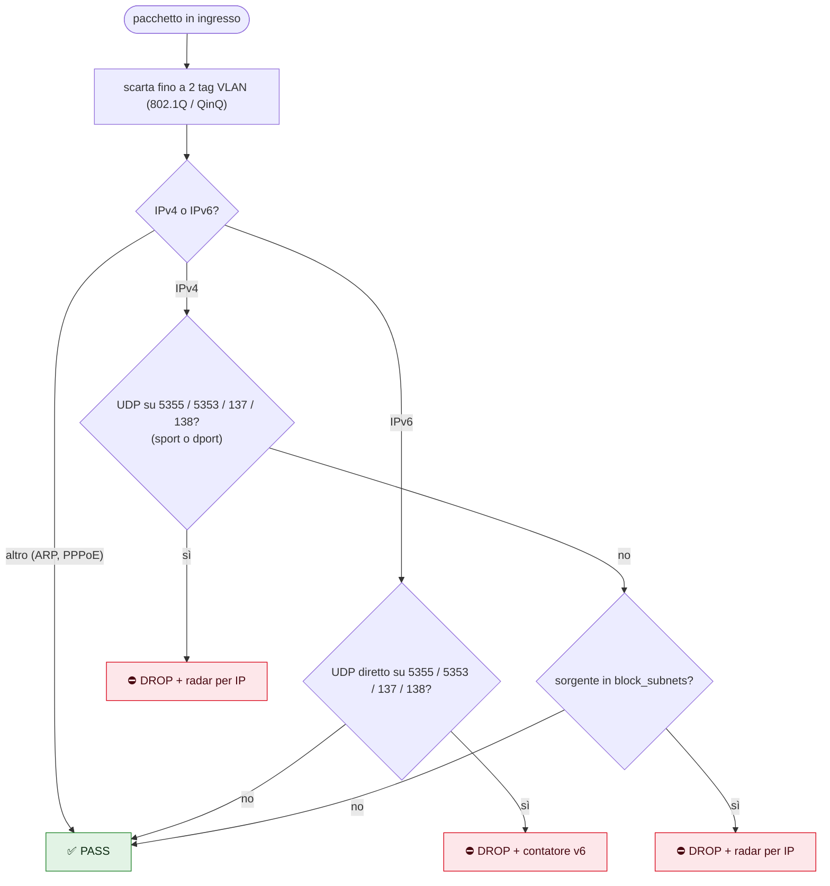
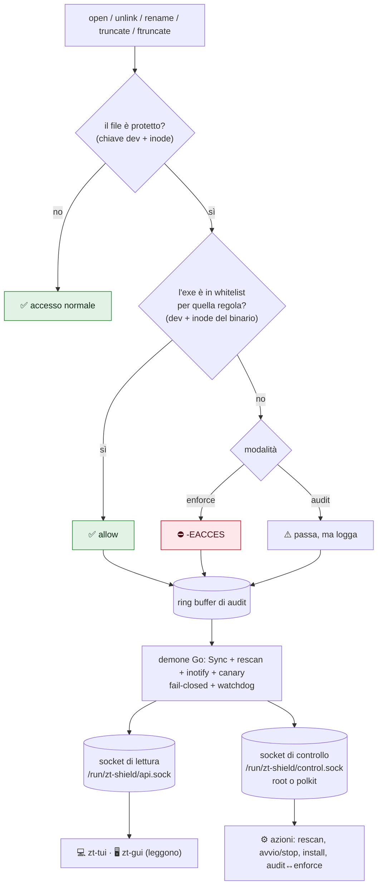

<p align="center">
  
</p>
<h1 align="center">ZeroShield</h1>
<p align="center"><b>Uno scudo zero-trust locale nel kernel Linux.</b><br/>
Difende segreti e rete di una postazione da Wi-Fi ostili, dipendenze avvelenate e ladri di token: senza server, senza cloud, senza account.</p>
<p align="center">
  <a href="#-stato-reale-del-progetto">Stato</a> ·
  <a href="#-demo-in-60-secondi-dati-finti">Demo</a> ·
  <a href="#-installazione">Installazione</a> ·
  <a href="#-configurazione">Configurazione</a> ·
  <a href="#-interfacce">Interfacce</a> ·
  <a href="#-documentazione">Documentazione</a>
</p>
<p align="center"><i>⚠️ ALPHA permanente finché gli hook LSM non sono collaudati in enforce — solo lab · MIT © 2026 ZioZoni95</i></p>
<p align="center">
  <a href="https://github.com/ZioZoni95/ZeroShield/actions/workflows/ci.yml"></a>
  
  
  
  
  
</p>

> [!WARNING]
> **Alpha sperimentale, mai provata su una macchina fisica.** Gli hook LSM che proteggono i segreti sono
> accettati dal verifier del kernel ma **non sono mai stati agganciati** su un kernel con BPF LSM attivo:
> il blocco effettivo dei file non è stato ancora visto funzionare. Usalo in una **VM con snapshot** e in
> modalità `audit` finché il collaudo di [`docs/TESTING_LAB.md`](docs/TESTING_LAB.md) non passa sulla tua
> macchina.

---

## 🧭 Cos'è

`zt-shield` è un agente di sicurezza locale per postazioni Linux (sviluppo e uso quotidiano) che lavorano
su reti non fidate o su cui può girare codice non fidato. Applica il paradigma **Zero-Trust** a livello
kernel con **eBPF (XDP + LSM)**, affiancato da hardening del sistema, esche anti-ransomware, monitor e
kill-switch VPN e firma dei commit con credenziali hardware.

* **Difende da:** poisoning di rete su Wi-Fi o LAN (LLMNR/mDNS/NBT-NS), codice di terze parti che legge
  `~/.ssh`, `~/.aws` e token (supply-chain, infostealer), ransomware, furto di chiavi SSH.
* **Non è:** un antivirus, un firewall completo (niente egress per processo), un EDR, un backup né uno
  strumento di cifratura. Root locale, keylogger e disco non cifrato restano fuori scopo.

---

## 🔬 Stato reale del progetto

Ultima release pubblicata: **v0.0.3** (pre-release). `main` contiene più della release: vedi
[`CHANGELOG.md`](CHANGELOG.md).

| Componente | Stato | Come è stato verificato |
|---|---|---|
| XDP anti-poisoning (IPv4 + IPv6, fino a 2 tag VLAN) e radar | ✅ **kernel reale** | `zt-probe -xdp-lo` + pacchetti sintetici contro il vero programma (`BPF_PROG_TEST_RUN`) |
| Canary anti-ransomware (fanotify) | ✅ **kernel reale** | tocco esca, allarme di massa, kill in `enforce` (`make test-root`) |
| **Hook LSM dei segreti** (5 programmi) | 🟡 **verifier ok, mai agganciati** | accettati dal verifier sul runner GitHub; attach e blocco reale **mai visti**: da provare in VM |
| **Demone end-to-end** | ⚠️ **mai in una VM con BPF LSM** | senza BPF LSM si ferma di proposito (fail-closed); i pezzi sono testati, mai insieme su un kernel di prova |
| Config, IPC, audit, whitelist, inotify, `netstat` | ✅ test unitari | `go test -race`, fuzz sul config, CI |
| TUI, GUI, mock | ✅ testati | test unitari e `--dump` (TUI); test della GUI nel browser contro un demone simulato |
| Pacchetto `.deb` | ✅ costruito, installato e rimosso | CI e prove locali |
| Kill-switch VPN, auto-VPN, helper Proton, `harden_system.sh`, `configure_service.sh` | 🟡 solo in namespace o con comandi finti | mai su una rete, un sistema o un `.deb` installato veri |
| `setup_fido2.sh`, unit systemd | ⚠️ solo sintassi | `shellcheck`, `systemd-analyze verify` |

**In pratica:** puoi guardare le interfacce con dati finti e provare XDP e canary su un kernel vero.
**Non** puoi ancora fidarti che i tuoi segreti siano protetti.

---

## ⚡ Demo in 60 secondi (dati finti)

Non prova la protezione (nessun kernel coinvolto): mostra le interfacce con **dati inventati**, senza root e
senza toccare il demone vero. Il finto demone `zt-mockd` genera anche eventi e **canary finti** a intervalli
regolari: non sono allarmi veri.

```bash
# con il pacchetto installato
ZT_SOCKET=/tmp/z.sock zt-mockd &
ZT_SOCKET=/tmp/z.sock zt-gui        # oppure zt-tui: una finestra collegata al finto demone
pkill zt-mockd                      # fine

# dai sorgenti
make build-tui build-mock
ZT_SOCKET=/tmp/z.sock ./bin/zt-mockd &
ZT_SOCKET=/tmp/z.sock ./bin/zt-tui
```

`./bin/zt-tui --dump` stampa un'anteprima senza terminale interattivo. La stessa demo, con i comandi da copiare,
è nella GUI (primo avvio, demone spento e scheda *Guida*).

---

## 🏗️ Come funziona

Il demone `zt-shield` gira come root, carica i programmi eBPF e pubblica stato ed eventi su un socket Unix
che TUI e GUI leggono come utente normale.

**Rete (XDP):** ogni pacchetto in ingresso, prima dello stack di rete.



**Segreti (LSM):** ogni `open`, `unlink`, `rename`, `truncate` del sistema passa da una lookup.



Il confine tra userspace e kernel è fatto di **numeri**, non di stringhe: per ogni file protetto si mette in
mappa `(device, inode)` e il kernel confronta i propri numeri con l'oggetto che sta per essere aperto. Per
questo la whitelist non si aggira con symlink, rename o copie del binario: conta l'identità del file, non il
nome con cui lo chiami.

---

## 🎯 Cosa protegge

* **Rete (XDP + firewall).** Scarta in ingresso LLMNR (5355), mDNS (5353), NBT-NS (137) e NetBIOS-DGM (138),
  guardando sia la porta sorgente sia quella di destinazione (la risposta avvelenata di Responder ha
  `sport=5355`). Il contatore non distingue le *richieste* degli altri host dalle *risposte avvelenate*. Vale
  per IPv4 e IPv6, anche dietro uno o due tag VLAN; il radar delle UI è solo IPv4. `block_subnets` scarta
  intere reti IPv4 (anche le risposte: mai gateway o DNS). XDP generico: funziona su Wi-Fi, Ethernet e VPN,
  con `interface` come lista (`wlan0,eth0`).
* **Segreti (LSM).** Hook su `open`, `unlink`, `rename`, `path_truncate` e, sui kernel ≥ 6.2, `file_truncate`
  (opzionale). Ogni regola associa file ai soli binari autorizzati; entrano in whitelist solo **binari di
  root** non scrivibili da altri. Una scrittura semplice passa, `O_TRUNC` e `truncate` passano dalla
  whitelist, `deny_write` per regola blocca anche quelle. I file nominati dalle regole hanno precedenza
  sulle mappe (tetto di 4096 per regola, 16384 in tutto) e un watcher **inotify** riallinea le mappe entro
  ~0,5 s da un rename; il rescan periodico (`rescan_seconds`) resta come rete di sicurezza.
  **Fail-closed**: se un hook non si aggancia il demone si ferma invece di fingersi attivo.
* **Anti-ransomware (canary + fanotify).** File esca nascosti nelle cartelle scelte: chi li tocca viene
  ucciso in `enforce` (mai PID ≤ 1 né il demone). Una raffica di scritture, cancellazioni o rinomine genera
  solo un allarme. `exclude_exe` e `allow_exe` esentano indicizzatori e backup. Spento di default: si tara una
  settimana in `audit` ([`docs/CANARY.md`](docs/CANARY.md)).
* **VPN.** Il demone **monitora, non applica**: mostra tunnel, kill-switch nftables e handshake WireGuard.
  `scripts/vpn_killswitch.sh` applica il kill-switch con una sola tabella nft (`inet zt-killswitch`);
  `nm_vpn.sh` e `proton_*.sh` sono opzionali. Tutto provato solo in un namespace o con comandi finti
  ([`docs/VPN_SETUP.md`](docs/VPN_SETUP.md)).
* **Identità (FIDO2).** `setup_fido2.sh` crea una chiave `ed25519-sk` residente (PIN + tocco) e configura
  commit firmati via SSH.
* **Hardening (`scripts/harden_system.sh`).** LLMNR e mDNS spenti in `systemd-resolved`, DNS-over-TLS nei
  profili per reti ostili, sysctl anti-redirect, `avahi` disabilitato, UFW `default deny incoming`. Usa
  **sempre `--dry-run` prima**: mostra diff e comandi senza modificare nulla.

---

## 🧩 Profili e regole

| Profilo | Modalità | Gruppi di regole | Hardening (`harden_system.sh`) |
|---|---|---|---|
| `home` *(default)* | `audit` | ssh, cloud, tokens, gpg | UFW, no LLMNR/mDNS, sysctl base |
| `corporate` | `enforce` | ssh, cloud, tokens, gpg | come `home`; DNS interni mantenuti |
| `public-wifi` | `enforce` | + browsers | + DoT opportunistic, ARP, avahi off |
| `paranoid` | `enforce` | come `public-wifi` | DoT `yes` (rompe i captive portal) |

| Gruppo | Protegge | Autorizzati |
|---|---|---|
| `ssh` | `~/.ssh/id_*` | ssh, ssh-add, ssh-agent, ssh-keygen, scp, sftp |
| `cloud` | `.kube/config`, `.aws/credentials`, credenziali Terraform | kubectl, helm, k9s, aws, terraform, tofu |
| `tokens` | `.git-credentials`, `.docker/config.json`, `gh/hosts.yml`, `.cargo/credentials.toml`, `glab-cli/config.yml` | git, gh, glab, docker, cargo |
| `gpg` | `~/.gnupg/private-keys-v1.d/` | gpg, gpg-agent, gpgsm |
| `browsers` | cookie e password di Chrome, Chromium, Firefox (anche snap), Brave | i binari dei browser (percorsi assoluti) |

Aggiungi i tuoi segreti con `extra_rules`, oppure sostituisci le regole del profilo con `rules`.

> [!IMPORTANT]
> Tool con shebang (`npm`, `pip`, `gcloud`, `az`) **non sono in whitelist** di proposito: il processo che apre
> il file è l'interprete (`node`, `python`), e autorizzarlo autorizzerebbe qualunque script, compresi gli
> `postinstall` malevoli. Per quei token usa credenziali a breve durata o un keyring. I browser **Flatpak**
> non sono coperti: verifica in `audit` il percorso del binario visto dal kernel.

---

## ⚙️ Configurazione

File: `/etc/zt-shield/shield.yaml` (`-config FILE` per un altro). Senza file vale il profilo `home`. Le chiavi
sconosciute sono **rifiutate** (un refuso non passa in silenzio). Il pacchetto installa l'esempio commentato
([`configs/shield.example.yaml`](configs/shield.example.yaml)) e non lo sovrascrive agli aggiornamenti.

| Chiave | Default | Significato |
|---|---|---|
| `profile` | `home` | `home` · `corporate` · `public-wifi` · `paranoid` |
| `user` | — | **Obbligatoria come servizio**: utente la cui home si protegge (sotto systemd non esiste `SUDO_USER`) |
| `mode` | dal profilo | `audit` (logga) · `enforce` (nega) |
| `interface` | rotta di default | interfaccia XDP; lista separata da virgole. **Le altre interfacce attive non sono filtrate** |
| `block_poisoning` | `true` | drop LLMNR/mDNS/NBT-NS in ingresso |
| `block_subnets` | — | CIDR IPv4 da scartare in XDP |
| `rules` / `extra_rules` | dal profilo | `name`, `paths` (relativi alla home o assoluti, glob, directory ricorsive), `allow` (nomi o percorsi assoluti, mai vuota), `deny_write` |
| `canary.*` | spento | `enabled`, `dirs`, `names`, `burst_count`, `burst_secs`, `exclude_exe`, `allow_exe` |
| `vpn.*` | spento | `enabled`, `endpoint` (IP:porta, mai un nome host), `tunnel`, `block_dhcp`, `allow_lan` |
| `log_format` | `text` | `text` · `json` (una riga per evento) |
| `rescan_seconds` | `30` | riallineamento periodico delle mappe (minimo 5) |

Variabili d'ambiente: `SHIELD_USER` (utente da proteggere in primo piano), `ZT_SOCKET` e `ZT_CONTROL` (solo
per mock e test: il demone root le **ignora**). Percorsi: socket di lettura `/run/zt-shield/api.sock`
(proprietà dell'utente protetto, `0600`), socket di controllo `/run/zt-shield/control.sock` (root, polkit
`org.zeroshield.manage`), script in `/usr/share/zeroshield/scripts/`, documentazione in
`/usr/share/doc/zeroshield/`.

---

## 📦 Installazione

> [!CAUTION]
> Installare il pacchetto **non attiva la protezione**: il servizio non parte da solo, serve `user:` nel
> config, serve `bpf` tra gli LSM del kernel (senza il demone si ferma di proposito) e gli hook non sono mai
> stati agganciati in `enforce`. Prima in una VM.

### Da pacchetto

Ogni tag `v*` pubblica una **pre-release** con **un solo `.deb`** (`zeroshield_<versione>_amd64.deb`:
demone, TUI, GUI, servizio, polkit e script) e `SHA256SUMS`. Ogni release è un'istantanea del codice al suo
tag, non cumulativa. Le versioni restano `0.0.x`; la `1.0.0` arriverà solo a prodotto testato e completo.

```bash
sha256sum -c SHA256SUMS --ignore-missing
sudo apt install ./zeroshield_*_amd64.deb      # server senza schermo: aggiungi --no-install-recommends

sudo zt-probe -xdp-lo                          # il kernel accetta i programmi?
sudo /usr/share/zeroshield/scripts/configure_service.sh $USER home   # scrive user:/profile:, parte in audit
zt-tui                                         # oppure zt-gui
```

`configure_service.sh` imposta `user:` e `profile:` nel config (con una copia di sicurezza, senza perdere i
commenti), parte **sempre in audit** e avvia il servizio del pacchetto: non copia binari né scrive un'altra
unit. Lo stesso fa il pulsante *Installa e attiva* della GUI. A mano: `sudoedit /etc/zt-shield/shield.yaml`
(`user:` è obbligatorio) e `sudo systemctl enable --now zt-shield`.

Le librerie grafiche (GTK e WebKit) sono *consigliate*: sul desktop apt le installa; senza di esse demone e
TUI funzionano, la GUI no. Fino a v0.0.3 la GUI era un pacchetto a parte (`zeroshield-gui`): il pacchetto
unico lo sostituisce e `apt` lo gestisce (`Replaces`/`Conflicts`).

### Prerequisito: BPF LSM attivo

Serve Linux con kernel ≥ 5.15 e BTF (`file_truncate` richiede ≥ 6.2, sui precedenti viene saltato). Controlla
`cat /sys/kernel/security/lsm`: se manca `bpf`, **appendilo alla lista esistente** (non sostituirla) e riavvia:

```bash
CURRENT_LSM="$(cat /sys/kernel/security/lsm)"
sudo cp /etc/default/grub /etc/default/grub.bak
sudo sed -i "s|^GRUB_CMDLINE_LINUX=\"|GRUB_CMDLINE_LINUX=\"lsm=${CURRENT_LSM},bpf |" /etc/default/grub
sudo update-grub && sudo reboot
```

`bash scripts/check_prereqs.sh` verifica kernel, BTF, LSM e toolchain.

### Da sorgente

Serve la toolchain: `clang llvm libbpf-dev linux-tools-generic make ufw` (`bpftool` arriva da
`linux-tools-generic`; il `Makefile` lo trova da solo, altrimenti `BPFTOOL=/percorso`), **Go ≥ 1.26** e, per
la GUI, Node 22 e `libgtk-3-dev libwebkit2gtk-4.1-dev` (la CLI `wails` solo per `make gui`).

```bash
make build                                 # genera vmlinux.h e stub eBPF, compila demone e TUI
make probe                                 # il kernel accetta i programmi? (sudo)
sudo SHIELD_USER=$USER ./bin/zt-shield     # prova in primo piano (profilo home = solo audit)

bash scripts/harden_system.sh home --dry-run    # PRIMA: mostra diff e comandi
sudo bash scripts/harden_system.sh home         # poi, in VM: corporate | public-wifi | paranoid
sudo bash scripts/install_service.sh $USER home # servizio systemd (solo da sorgente; dal .deb c'è configure_service.sh)
make package                                    # dist/zeroshield_<versione>_<arch>.deb (demone + TUI + GUI)
```

### Primo avvio sicuro

1. **VM con snapshot**, kernel con `bpf` in `lsm=`, solo segreti finti ([`docs/TESTING_LAB.md`](docs/TESTING_LAB.md)).
2. `make probe`: tutti i programmi devono risultare ✅.
3. Parti in **`audit`** e lascia lavorare qualche giorno: il log dice, per ogni accesso, regola, PID ed `exe`.
4. Passa a **`enforce`** (in `shield.yaml` o dalla scheda Configurazione) solo quando il log non mostra più
   accessi legittimi.
5. Collaudo: `cat ~/.kube/config` deve dare *Permission denied*; `cp /usr/bin/cat /tmp/ssh && /tmp/ssh ~/.kube/config`
   deve restare negato (conta l'identità, non il nome); `kubectl get pods` deve passare.
6. Hardening, VPN e canary uno alla volta, ognuno prima con snapshot.

---

## 🖥️ Interfacce

Il demone pubblica stato ed eventi sul socket di lettura, di proprietà dell'utente in `user:` con modo `0600`:
lo leggono solo lui e root (contiene PID, exe e percorsi), quindi un secondo utente locale non vede GUI e TUI
(*permission denied*: è voluto). Leggere è libero; **agire** (rescan, avvio/stop, install, audit↔enforce)
passa dal canale di controllo (controllo delle credenziali del peer + polkit `auth_admin`) o da `pkexec`:
mai click silenziosi, mai password maneggiate dalle UI. Ogni testo che arriva dai processi osservati è
sanificato nel demone (`ipc.SafeText`) prima di raggiungere TUI e GUI.

| Strumento | Cosa è |
|---|---|
| `zt-shield` | Il demone (`sudo zt-shield` o servizio). Sottocomandi: `ctl ping\|rescan`, `dropin` (drop-in systemd per il canary) |
| `zt-tui` | Terminale con sei schede (Stato, Eventi, Regole, Rete, Radar, Config), filtro eventi, azioni (`i` installa, `s` avvia, `X` ferma, `m` mode, `R` rescan) e `--dump` |
| `zt-gui` | Finestra desktop (Wails): verdetto di protezione, eventi raggruppabili, radar che separa rumore di rete da sorgenti da verificare, regole, rete e VPN, configurazione con cambio audit/enforce, guida a schede e primo avvio con controlli preliminari. Scorciatoie `1`-`7` |
| `zt-mockd` | Finto demone con dati inventati, per vedere le UI senza root né eBPF |
| `zt-probe` | Collaudo del kernel: verifier per programma e, con `-xdp-lo`, XDP su loopback |

Fuori da un ambiente snap le GUI GTK vanno lanciate con `GTK_PATH` e `GIO_MODULE_DIR` ripuliti. Ricerca e
decisioni di design in [`docs/UI_RESEARCH.md`](docs/UI_RESEARCH.md).

---

## ✅ Test e CI

```bash
make test           # Go: unitari, nessun privilegio
make test-scripts   # script con comandi finti (VPN, Proton, configure_service, hardening) + kill-switch in un namespace (sudo)
make test-root      # canary con fanotify reale + parser XDP e loader con BPF_PROG_TEST_RUN (sudo)
make probe          # il kernel accetta i programmi eBPF? (sudo)
make check          # prerequisiti + lint + test + build

# GUI nel browser (Chrome di sistema, demone simulato; non salva nulla in package.json)
cd zt-gui/frontend && npm ci && npm run build && npm i --no-save playwright-core && node tests/gui.test.mjs dist
```

I test degli script usano **comandi finti** nel `PATH` e file temporanei: non toccano mai UFW o DNS veri.

La CI (`.github/workflows/ci.yml`, su push a `main`, pull request e ogni lunedì) esegue cinque job: **Lint**
(`gofmt`, `go vet`, `staticcheck`, `shellcheck`), **Test** (`go test -race`, fuzz del config, script, canary da
root), **eBPF** (`clang` + `bpf2go`, build, `zt-probe` sul kernel del runner), **GUI** (Vite + `npm audit`,
test nel browser, build Wails, `.deb` unico verificato) e **Sicurezza** (`govulncheck`, `gosec`). Dependabot
aggiorna Go, npm e le GitHub Actions; `release.yml` pubblica il `.deb` ai tag `v*`.

---

## 🗂️ Struttura

```text
bpf/        kernel C (1 XDP + 5 LSM), loader a runtime e test; gli stub generati non sono versionati
cmd/        zt-shield (demone) · zt-tui · zt-mockd · zt-probe
internal/   config · lsm · xdp · audit · canary · netstat · vpn · priv (canale privilegiato) · watchdog
pkg/        ipc (socket di lettura, SafeText) · svc (azioni di servizio dalle UI)
zt-gui/     GUI Wails (frontend Vite + Go) con i suoi test nel browser
configs/    shield.example.yaml
scripts/    hardening, FIDO2, servizio, VPN (kill-switch, NetworkManager, Proton) e relativi test
packaging/  nfpm (.deb), unit systemd, policy polkit, .desktop
docs/       documentazione (vedi sotto)
```

---

## 🚧 Limiti noti

**Strutturali: si mitigano, non si risolvono.**

* **Root = game over.** Chi ha root scarica gli hook e legge tutto. Contano solo LUKS e backup offline.
* **Whitelist per binario, non per catena.** Ogni binario in lista legge i suoi file per chiunque lo invochi.
  Il segreto forte resta la chiave FIDO2.
* **`io_uring` = fail-open** (scelta per evitare falsi blocchi) e **niente hook `ptrace`**: un processo con lo
  stesso UID legge la memoria di `ssh` (mitigato da `kernel.yama.ptrace_scope=1`).
* **btrfs e overlayfs: protezione inerte** (avviso all'avvio): solo ext4 e xfs.
* **Servizio fermo = zero protezione**: nessun pinning degli hook, di proposito.

**Da sapere prima di `enforce`.**

* Nessun hook LSM è mai stato agganciato su un kernel con BPF LSM (vedi lo stato sopra).
* Il radar è solo IPv4 e il poisoning IPv6 dietro extension header passa.
* Dopo un aggiornamento (apt, snap) l'inode di un browser cambia e resta fuori whitelist fino al rescan.
* Il canary uccide dopo il tocco e non ferma scritture in-place che saltano le esche.
* Il demone non applica il kill-switch VPN: applicarlo in automatico può spegnere la rete.

L'elenco completo e aggiornato è in [`docs/PUNTI_APERTI.md`](docs/PUNTI_APERTI.md).

---

## 📖 Documentazione

| Documento | Cosa contiene |
|---|---|
| [`CHANGELOG.md`](CHANGELOG.md) | Cosa cambia in ogni versione, comprese le modifiche non ancora rilasciate |
| [`docs/PUNTI_APERTI.md`](docs/PUNTI_APERTI.md) | Stato, collaudi mancanti, decisioni aperte |
| [`docs/TEST_SANDBOX.md`](docs/TEST_SANDBOX.md) · [`TESTING_LAB.md`](docs/TESTING_LAB.md) · [`TESTING.md`](docs/TESTING.md) | Cosa è stato provato su kernel reale; collaudo in VM isolata; collaudo pratico di LSM, XDP, FIDO2 e pentest esterno |
| [`docs/CANARY.md`](docs/CANARY.md) · [`VPN_SETUP.md`](docs/VPN_SETUP.md) | Anti-ransomware: uso e taratura; kill-switch, auto-VPN, ProtonVPN |
| [`docs/UI_RESEARCH.md`](docs/UI_RESEARCH.md) | Ricerca TUI/GUI e architettura IPC |
| [`docs/ROADMAP.md`](docs/ROADMAP.md) · [`FEATURE_*.md`](docs/) | Piano a fasi e studi sulle estensioni |
| [`docs/FIX_APPLICATI.md`](docs/FIX_APPLICATI.md) · [`gemini-code-*.md`](docs/) | Registro dei fix e specifiche iniziali |
| [`docs/README.md`](docs/README.md) | Indice di `docs/` con l'ordine di lettura consigliato |

---

<p align="center"><sub>ZeroShield è un progetto personale e sperimentale, rilasciato con licenza MIT. Nessuna garanzia: leggi lo <a href="#-stato-reale-del-progetto">stato reale</a> prima di fidarti di qualunque cosa.</sub></p>
